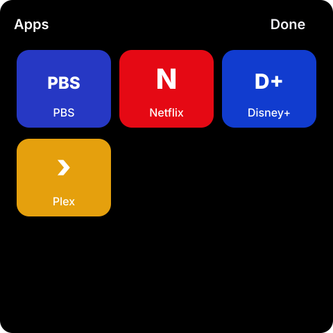
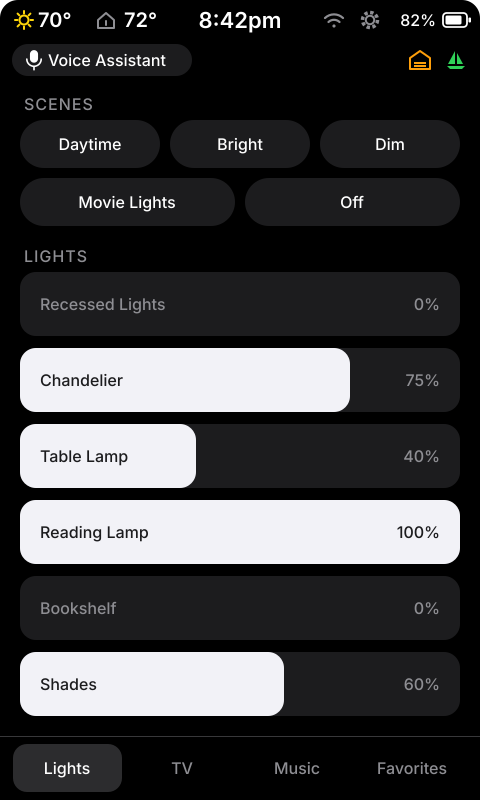
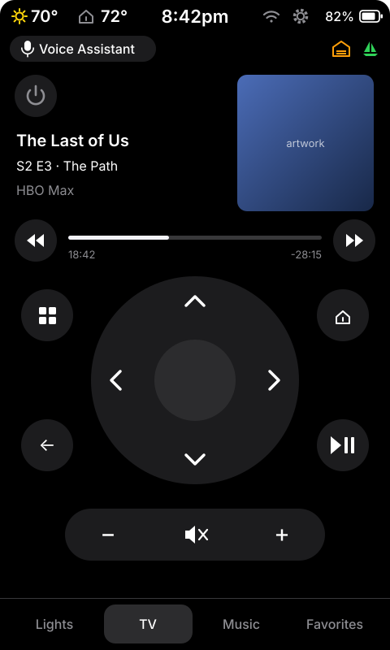
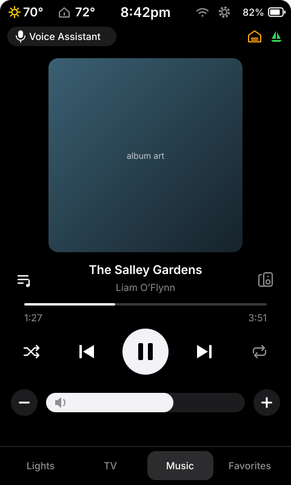
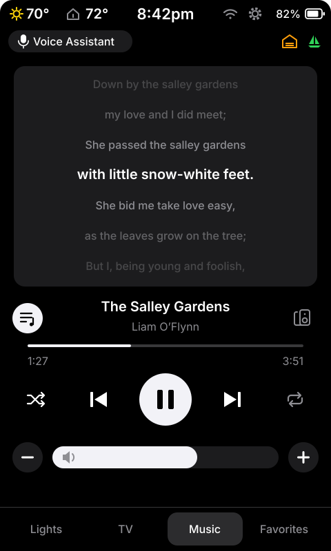

# esphome-lvgl-panel

A touch panel for Home Assistant, built with ESPHome and LVGL, that looks and
feels like a phone: dark theme, clean typography, big touch targets. One
shared design runs on every panel in the house (and in other houses), while
each panel keeps its own rooms, lights, speakers and TV.

| Lights | TV | Music | Favorites |
|:---:|:---:|:---:|:---:|
|  |  |  |  |

| Weather | Climate | Settings | Night clock |
|:---:|:---:|:---:|:---:|
|  |  |  |  |

| Snow report | Timer | Music Assistant favorites | Voice |
|:---:|:---:|:---:|:---:|
|  |  |  |  |

| Play on | Holiday themes | Camera pop-up | Messages |
|:---:|:---:|:---:|:---:|
|  |  |  |  |

| TV apps | Marine forecast | Light sheet | Sleep note |
|:---:|:---:|:---:|:---:|
|  |  |  |  |

**The handheld remote** (4.3″ portrait, battery) — the same tabs, laid out
for one hand:

| Lights | TV | Music | Lyrics |
|:---:|:---:|:---:|:---:|
|  |  |  |  |

*Illustrations drawn to the panel's real layout and colors; photos welcome.*

## What it does

- **Lights** — scene buttons and big iOS-style sliders for lights, fans and
  shades. Tap a name to toggle, drag to dim, hold for warmth and color.
- **TV** — an Apple TV remote (d-pad, home, back, play/pause, skip, volume),
  an **Apps** sheet of large app-logo buttons, power tucked in a corner, and
  the artwork of whatever is playing.
- **Music** — Now Playing for a Music Assistant or Sonos speaker: artwork,
  progress, play/pause, shuffle, repeat, volume − / + buttons and a full-width
  slider, and **Play on** to group other speakers.
- **Lyrics** — the words of the song playing, following along line by line
  (from [LRCLIB](https://lrclib.net) through Home Assistant; no account
  needed).
- **Favorites** — a grid of playlists and stations, one tap to play: a few
  hand-picked tiles, or your Music Assistant favorites,
  live and recently played first, with Playlists / Radio / Albums / Artists
  chips.
- **Timer** — on the Waveshare P4 panel: preset and custom timers, and timers
  set by voice, with a chime when time's up.
- **Status bar** — time, outside weather, indoor temperature, small status
  icons (garage open, packages waiting, …) and the HA connection.
- **Weather** — current conditions in colour (moons after dark), feels-like,
  sunrise and sunset, the next 15 hours, and 5 days with temperature-range
  bars.
- **Climate** — a thermostat dial with Off / Heat / Cool / Auto.
- **Snow report** — new snow in the status bar and a winter-themed ski report
  (depths, season total, lifts and runs open).
- **Camera pop-ups** — the gate opens or the doorbell rings, and the camera
  appears.
- **Voice** — on the Waveshare P4 panel, say "Okay Nabu" and ask Home
  Assistant's Assist; the panel shows what it heard and speaks the answer.
  A mic icon in the status bar mutes it. On the handheld remote, tap
  **Voice Assistant** and talk.
- **Handheld remote** — a battery-powered portrait version: battery level,
  tap to wake, standby when left alone, gate and doorbell pop-ups.
- **Messages** — Home Assistant automations can put a banner on any panel
  ("Washer done", "Mail arrived").
- **Holiday themes** — Halloween, Christmas, Valentine's Day and St. Patrick's
  Day colours, a countdown and drifting icons on the night clock; switched on
  per panel from Home Assistant.
- **Screen care** — dims, sleeps or shows a night clock; night mode; nightly
  anti-burn.
- **Settings on the panel and in Home Assistant** — brightness, slider color,
  screen timing, night mode, 24-hour clock, PIN lock, cleaning mode, an About
  page with a QR code, and a notice when an update is out.
- **TV and Music tabs open themselves** when something starts playing.

Every feature is optional and every list (scenes, lights, apps, speakers,
favorites, status icons) has as many entries as a room needs.

## Hardware

| Board | File |
|---|---|
| Guition ESP32-S3-4848S040 (4″, 480×480, ST7701S display, GT911 touch, 16 MB flash, 8 MB PSRAM) | `hardware/guition-4848s040.yaml` |
| Waveshare ESP32-P4-WIFI6-Touch-LCD-4B (4″, 720×720 MIPI-DSI, GT911 touch, Wi-Fi 6, speaker + 2 mics, 32 MB flash, 32 MB PSRAM, 86 mm wall box) | `hardware/waveshare-esp32-p4-86-4b.yaml` |
| Guition JC4880P443C_I_W (4.3″, 480×800 portrait MIPI-DSI, GT911 touch, ESP32-P4 + C6 Wi-Fi 6, battery connector, speaker connector + mic, 16 MB flash, 32 MB PSRAM) — the handheld remote | `hardware/guition-jc4880p443.yaml` |

The design is drawn once and scaled to each board: the 720×720 panel looks
the same as the 480×480 one, only sharper. The 480×800 board gets its own
portrait layout.

Requires ESPHome **2026.10.0** or newer and Home Assistant with the ESPHome
integration. Music features work best with
[Music Assistant](https://music-assistant.io/).

## Documentation

| Guide | What's in it |
|---|---|
| [Getting started](docs/getting-started.md) | From a new board to a working panel, step by step. |
| [Using the panel](docs/features.md) | Every screen and feature, and how to set each one up. |
| [Display file reference](docs/display-file.md) | Every file you can include and every setting it takes. |
| [Home Assistant side](docs/home-assistant.md) | The HA packages, the entities each panel adds, messages, automation examples. |
| [Customizing and extending](docs/customizing.md) | Colors, fonts, and how to write your own tabs and items. |
| [Troubleshooting](docs/troubleshooting.md) | Common problems and fixes. |
| [Changelog](CHANGELOG.md) | What changed in each release. |

## Quick start

1. Flash nothing yet — first copy [`examples/display-template.yaml`](examples/display-template.yaml)
   (or [`examples/remote-template.yaml`](examples/remote-template.yaml) for
   the handheld remote) into your Home Assistant's `/config/esphome/` and
   fill in the lines marked ◀.
2. Add the secrets it names to `/config/esphome/secrets.yaml`.
3. Copy [`ha/panel_weather.yaml`](ha/panel_weather.yaml) and
   [`ha/panel_messages.yaml`](ha/panel_messages.yaml) (and optionally
   [`ha/panel_updates.yaml`](ha/panel_updates.yaml)) into HA's `/config/packages/`
   and restart Home Assistant.
4. Install over USB from the ESPHome dashboard (first time only), adopt the
   device in HA, and turn on **"Allow the device to perform Home Assistant
   actions"** in its ESPHome integration options.

The full walk-through is in [Getting started](docs/getting-started.md).

## License

MIT — see [LICENSE](LICENSE). App logos and artwork you add to your panels are
not part of this repository.
