# Using the panel

Each section shows what a feature does on the panel and the lines that turn it
on in a display file. Display file snippets use the GitHub form (an entry in
the `files:` list); see [Display file reference](display-file.md) for the
local `!include` form and every option.

- [The status bar](#the-status-bar)
- [Lights tab](#lights-tab)
- [Light color sheet](#light-color-sheet)
- [TV tab](#tv-tab)
- [Music tab and Play on](#music-tab-and-play-on)
- [Favorites tab](#favorites-tab)
- [Favorites from Music Assistant](#favorites-from-music-assistant)
- [Timer tab](#timer-tab)
- [Weather](#weather)
- [Climate](#climate)
- [Status icons (chips)](#status-icons-chips)
- [Marine forecast](#marine-forecast)
- [Snow report](#snow-report)
- [Camera pop-ups](#camera-pop-ups)
- [Holiday themes](#holiday-themes)
- [Sleep screen notes](#sleep-screen-notes)
- [Voice](#voice)
- [Messages from Home Assistant](#messages-from-home-assistant)
- [Settings](#settings)
- [Screen dimming, sleep and the night clock](#screen-dimming-sleep-and-the-night-clock)
- [Night mode](#night-mode)
- [PIN lock](#pin-lock)
- [Cleaning mode](#cleaning-mode)
- [Updates](#updates)
- [About and restart](#about-and-restart)

---

## The status bar

Left to right: **outside weather** (tap for the forecast), **indoor
temperature** (tap for the thermostat), the **time**, **status icons**, the
**microphone** (panels with [voice](#voice)), the **connection icon** and the
**gear** (Settings).

- The connection icon is grey while Home Assistant is connected and turns
  **red (Wi-Fi off)** when HA isn't. Buttons don't work while it's red.
- Weather, climate and status icons only appear if the display file includes
  them.

## Lights tab

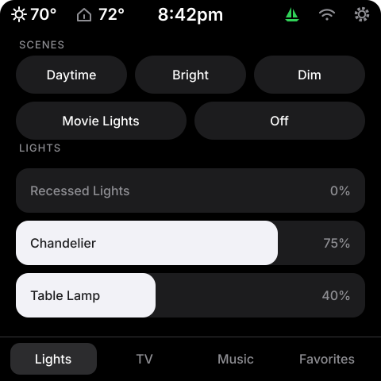

Always the first tab.

**Scenes** — a row of pill buttons (three per row; a final row of two gets
wider buttons). Rooms without scenes hide the SCENES section and give the
sliders the whole tab.

**Lights, fans and shades** — Control Center-style sliders.

- **Drag** anywhere to set brightness (or fan speed); Home Assistant is updated
  once, when you lift your finger.
- **Tap the name** to toggle the light on/off (shades: open/close, or stop
  while moving).
- **Hold the name** of a light with color or white tones to open its
  [color sheet](#light-color-sheet).
- The percentage follows changes made anywhere else (wall switch, app, HA).
- Fans show **Off** at 0; fans with fixed speeds (e.g. Lutron 25/50/75/100)
  snap to the nearest speed.
- Shades, blinds and curtains show **Closed**, a percentage, or **Open**;
  drag to set the position. Covers without positions: drag fully right to
  open, fully left to close.
- Three sliders fit; more scroll.

```yaml
- path: items/scene.yaml
  vars: { slot: 1, name: "Evening", entity: scene.living_room_evening }
- path: items/action_chip.yaml            # a chip that runs any HA action
  vars: { slot: 2, name: "Off", action: light.turn_off, entity: "light.lamp, light.ceiling" }
- path: items/light.yaml
  vars: { slot: 1, name: "Ceiling", entity: light.living_room_ceiling }
- path: items/fan.yaml
  vars: { slot: 2, name: "Fan", entity: fan.living_room }
- path: items/cover.yaml                 # shade, blind or curtain
  vars: { slot: 3, name: "Shade", entity: cover.living_room_shade }
```

`slot` sets the order. Scene chips and action chips share one numbering;
lights, fans and shades share another. With shades in the list you may want
the heading to say so: set `lights_title: "LIGHTS & SHADES"` in `substitutions`.

> **Tip — scenes that span several systems.** If a room mixes Hue scenes and
> Lutron dimmers, make an HA scene for the Lutron levels and give the chip
> both: `action: scene.turn_on`, `entity: "scene.relax_lutron, scene.relax_hue"`.
> See [Room scenes with several lighting systems](home-assistant.md#room-scenes-with-several-lighting-systems).

## Light color sheet

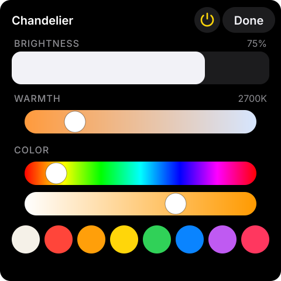

Hold a light's name on the Lights tab. The sheet shows:

- **Brightness** — drag to 0 to turn the light off.
- **Warmth** — warm (left) to cool (right), for lights with white tones.
- **Color** — a rainbow hue slider, a saturation slider (white to full
  color) and a row of quick swatches: white, then seven colors. White sets
  a neutral 4000 K on lights with white tones (zero saturation otherwise).

Sections the light doesn't support are hidden, and lights that only dim
don't open the sheet. The power button (yellow while on) toggles the light.
Changes are sent when you lift your finger, and the sheet follows changes
made elsewhere while it's open. Nothing to add to the display file: every
`items/light.yaml` light gets it.

> **Groups of bulbs.** Use the bulbs' own group (for Hue, a room or zone) so
> the sheet gets warmth and color. A template light only gets them if it
> defines `temperature` / `hs` and `set_temperature` / `set_hs`.

## TV tab

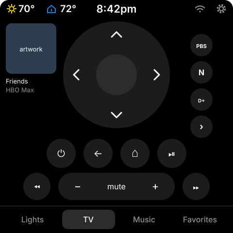

Modeled on the iOS Remote app, for an Apple TV.

- **D-pad** — swipe-free arrows and a center select button.
- **Power** (tap: wake the Apple TV; hold: sleep), **Back**, **Home**,
  **Play/Pause**.
- **Skip back / forward** either side of the volume pill.
- **Volume − / mute / +** — can control a different device than the Apple TV
  (for example a Sonos soundbar), and mute can target yet another (the TV).
- **Now playing** (top left, only while playing or paused) — the show's
  artwork, name and app.
- **App buttons** (right of the d-pad, optional) — tap to open the app on the
  Apple TV.

```yaml
- path: tabs/tv_appletv.yaml
  vars:
    tab_position: 2
    tv_remote: remote.living_room_apple_tv
    tv_player: media_player.living_room_apple_tv
    tv_volume_player: media_player.living_room_sonos   # what − / + control
    tv_mute_player: media_player.living_room_sonos     # what mute controls
- path: items/tv_app.yaml
  vars:
    slot: 1
    icon: ../www/tv_app_icons/netflix.svg   # your own image, next to the display file
    source: "Netflix"                       # exactly as in the Apple TV's source list
    entity: media_player.living_room_apple_tv
```

**App icons.** Logos are trademarks, so this repository doesn't ship them. Put
a square image per app (PNG, JPG or SVG; a white logo on a transparent
background matches the remote) somewhere under `/config/www/` and point `icon`
at it, relative to the display file. One source of single-color brand SVGs is
the [custom-brand-icons](https://github.com/elax46/custom-brand-icons) HACS
set. Leave out all `tv_app` items and the app column disappears.

**Source names** must match the Apple TV's `source_list` exactly — check
**Developer Tools → States → your Apple TV → source_list**.

## Music tab and Play on

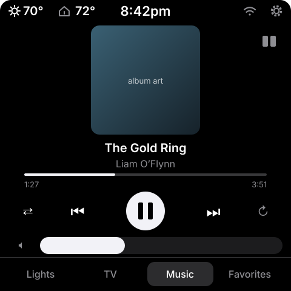

Now Playing for one speaker — a Music Assistant player works best (the
artwork, shuffle/repeat and grouping are all reliable).

- Artwork, title, artist, progress bar with elapsed / total time.
- **Previous / Play-Pause / Next**; **shuffle** (left) and **repeat** (right,
  cycles off → all → one) light up white when active.
- **Mute** and a **volume slider** that follows the speaker.
- **Play on** (speaker icon, top right) — opens a list of other speakers.

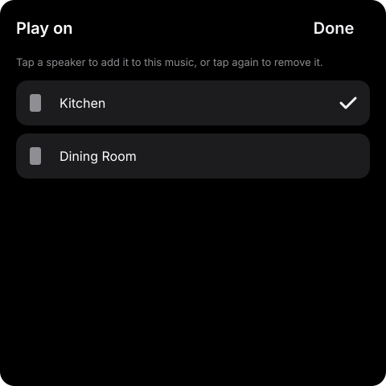

Tap a speaker to add it to the music playing in this room; tap again to remove
it. A checkmark shows which speakers are grouped, and the corner icon lights
up while any are. A grouped speaker also gets its own **volume slider** under
its name, for when one room is louder than the others (the main slider still
sets this room's speaker). **Match volumes** (at the bottom, while speakers
are grouped) sets every grouped speaker to this room's volume in one tap. Grouping uses `media_player.join` / `unjoin` with this room's
player as the leader.

```yaml
- path: tabs/music.yaml
  vars: { tab_position: 3, music_player: media_player.living_room }
- path: items/speaker.yaml
  vars: { slot: 1, name: "Kitchen", entity: media_player.kitchen, leader: media_player.living_room }
```

No `speaker` items → no Play on button.

## Favorites tab

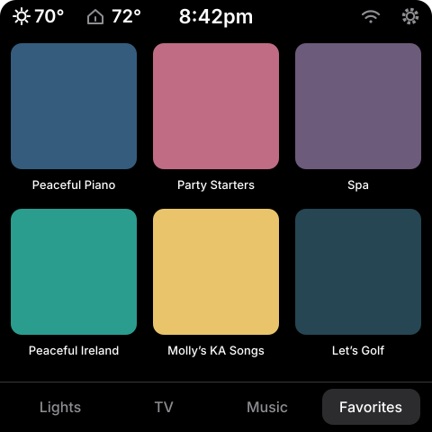

A grid of artwork tiles (three per row, more scroll). Tap to play on the
chosen speaker; shuffle can be switched on per tile.

```yaml
- path: tabs/favorites.yaml
  vars: { tab_position: 4 }
- path: items/favorite.yaml
  vars:
    slot: 1
    name: "Morning Jazz"
    image: ../www/playlist_icons/morning_jazz.png   # square image, compiled into the firmware
    media_content_id: "https://open.spotify.com/playlist/…"
    player: media_player.living_room
    shuffle: "true"     # "false" for radio stations
```

`media_content_id` is anything your player's `media_player.play_media`
accepts — Spotify URLs, Music Assistant URIs (`apple_music--xxxx://playlist/…`),
radio station URIs, etc. A quick way to find one: play the item in Music
Assistant and copy its URI from the item's details.

## Favorites from Music Assistant

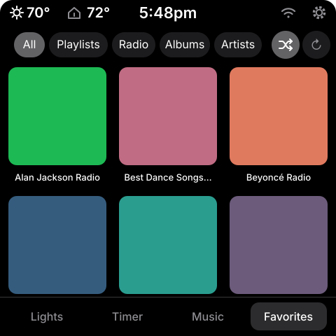

The Favorites tab can instead show your **Music Assistant favorites**, live:
favorite a playlist, station, album or artist in Music Assistant and it
appears on the panel, with no reinstall. Chips filter the grid (All,
Playlists, Radio, Albums, Artists; empty categories are hidden). Tap a tile to
play it on the room's player, replacing what's queued. The tile shows
"Starting…" for a few seconds while Music Assistant gets going; other taps
wait until then, so a second tap can't queue a second reload.

```yaml
- path: tabs/ma_favorites.yaml
  vars:
    tab_position: 4
    music_player: media_player.kitchen      # Music Assistant player to play on
    ma_url: "http://192.168.0.10:8095"      # Music Assistant's address
```

- **Shuffle** (the crossed arrows next to the chips) applies to playlists,
  albums and artists; radio never shuffles. The setting is kept across
  restarts.
- **Refresh** (the circular arrow) re-reads the list now; it is also re-read
  every 15 minutes.
- Up to 36 favorites, in the order playlists, radio, albums, artists.
- Artwork is downloaded once, one tile at a time, when the list changes
  (expect a few seconds of slightly jerky scrolling after a restart). JPEG and
  PNG artwork are shown; anything else keeps the music-note placeholder.

Needs the `panel_ma_favorites.yaml` package in Home Assistant (see
[Home Assistant side](home-assistant.md#packages-to-install)); update it
together with the panels, since the two share a compact list format. Works on
every board: each picture is kept in PSRAM (about 40 KB on 480×480, 90 KB on
720×720), and the tab itself needs little internal RAM. The hand-picked
`tabs/favorites.yaml` is still there if you prefer a few fixed tiles.

**Images and memory:** every picture the panel downloads (album art, TV art,
favorites, camera snapshots) goes through one of two shared image loaders,
because each loader keeps an ~18 KB decoder in the board's internal RAM once
it has been used. Each screen keeps its own copy of its picture in PSRAM.

## Timer tab

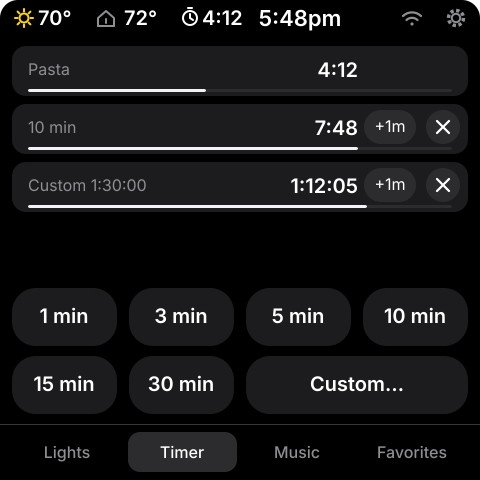

On a panel with voice (the Waveshare P4), a Timer tab with preset buttons
(1, 3, 5, 10, 15 and 30 minutes) and **Custom…** (hours / minutes / seconds
wheels, then Start).

```yaml
- path: tabs/timer.yaml
  vars: { tab_position: 2 }   # optional: preset_1 … preset_6, in minutes
```

- Up to three timers run at once. Each row shows the time left and a
  progress line, with **+1m** and **✕** (cancel).
- Timers set by voice ("Okay Nabu, set a pasta timer for 10 minutes") show
  in the same list. Cancel those by voice ("cancel the pasta timer").
- When a timer ends, the panel wakes, opens the tab, shows **Time's up** and
  chimes on its speaker until you tap **Stop** (or for 5 minutes).

| Custom… | Time's up |
|:---:|:---:|
| 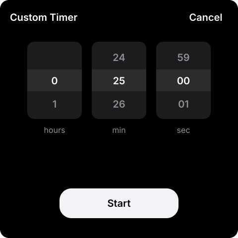 | 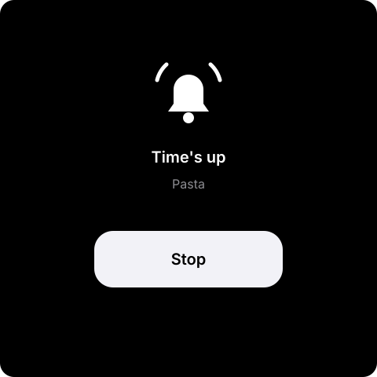 |
- While a timer runs, a timer icon in the status bar shows the time left;
  tap it to open the tab.

Needs `features/voice_assistant.yaml`.

## Weather

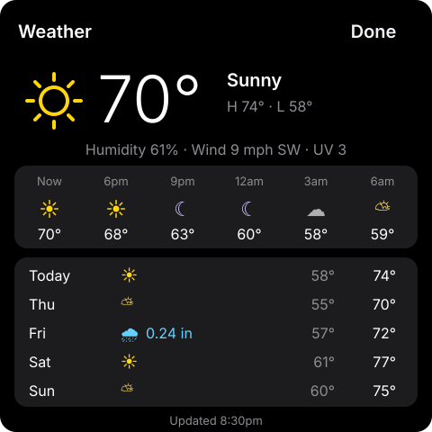

The status bar shows the current condition and temperature; **tap it** for
the weather sheet: current conditions, today's high/low, humidity, wind and UV,
the next 15 hours (every 3 hours) and the next 5 days with any rain.
Condition icons are coloured by condition (yellow sun, blue rain, orange
storms, icy blue snow, red for anything unusual) and turn into moons after
sunset. Each day's low–high sits on a bar scaled to the week, coloured from
cool to warm, with a dot for the current temperature on Today. The header
shows the next sunrise and sunset.

```yaml
- path: features/weather.yaml
  vars:
    weather_entity: weather.home
    forecast_entity: sensor.panel_weather_forecast          # from ha/panel_weather.yaml
    outdoor_temp_entity: sensor.backyard_temperature        # optional: your own thermometer
    feels_like_entity: sensor.backyard_feels_like           # optional: "Feels like" line
```

- The forecast needs [`ha/panel_weather.yaml`](../ha/panel_weather.yaml) in Home
  Assistant (HA no longer stores forecasts as attributes; this package fetches
  them every 30 minutes). Without it the sheet shows current conditions only.
- `outdoor_temp_entity` (optional) replaces the forecast's temperature with a
  local sensor such as a rooftop weather station.
- `feels_like_entity` (optional) adds "Feels like 64°" under the high/low:
  any apparent-temperature sensor (a weather station's feels-like, or a
  weather integration's). Most weather entities don't carry one.
- Substitutions: `temp_unit` (`F` or `C`, for the bar colours), `wind_unit`,
  `rain_unit`, `sun_entity` (default `sun.sun`, for night icons).

## Climate

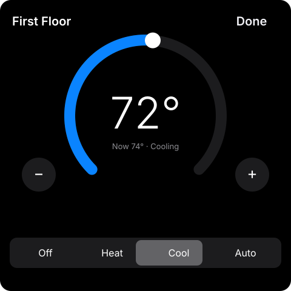

The status bar shows the **indoor temperature** with a small house icon —
**orange while heating, blue while cooling**. Tap it for the thermostat:

- **Heat / Cool:** drag the dial or use − / +; the target, the current
  temperature and what the system is doing are shown in the middle.
- **Auto** (HA's heat/cool mode): **Heat to** and **Cool to** rows, each with
  − / +.
- **Off / Heat / Cool / Auto** buttons at the bottom.

Changes are sent about a second after your last tap, so several taps become
one command.

```yaml
- path: features/climate.yaml
  vars: { climate_entity: climate.first_floor, climate_name: "First Floor" }
```

## Status icons (chips)

Small icons in the status bar that appear only when something needs
attention — for example the garage door open, or packages waiting (with a
count). The marine sailboat is its own chip, built into
[`features/marine.yaml`](#marine-forecast).

```yaml
- path: features/status_chip.yaml
  vars:
    chip_id: garage                         # unique name
    slot: 1                                 # 1 = rightmost
    entity: cover.garage_door
    icon: "\U000F06DA"                      # mdi-garage-open
    color: "0xFF9F0A"                       # orange
    show_when: "open,opening"               # states that show it, or "nonzero"
    show_value: "false"                     # "true" shows the number next to it
```

- **Icons** are [Material Design Icons](https://pictogrammers.com/library/mdi/)
  code points: open an icon, copy its code (e.g. `F06DA`) and write it as
  `"\U000F06DA"`. The panels use MDI **v7.4.47** — icons added later won't show.
- **Numbers:** `show_when: "nonzero"` with `show_value: "true"` shows e.g. a
  package icon with "2" while a counter is above zero.
- **Two-state icon** (always visible, green or red): include two chips on
  complementary entities (e.g. `binary_sensor.advisory` and
  `binary_sensor.no_advisory`), each with `show_when: "on"` and its own color.
- About three fit next to the clock.

## Marine forecast

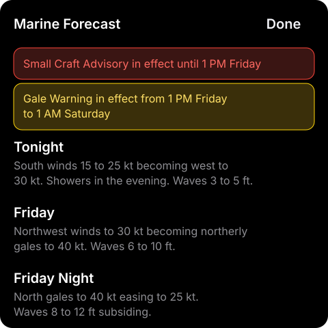

A sailboat in the status bar shows the marine hazards for your stretch of
coast, and tapping it opens the full-text nearshore forecast:

- **Red** — a Small Craft Advisory, Gale Warning, Storm Warning or other
  marine hazard is in effect now. A red card at the top of the sheet shows it.
- **Yellow** — nothing in effect, but one is issued for later, a watch is out,
  or the forecast carries a headline. An amber card shows what's coming.
- **Green** — no hazards.

The forecast periods scroll below the cards.

```yaml
- path: features/marine.yaml
  vars:
    marine_entity: sensor.panel_marine      # from ha/panel_marine.yaml
    title: "Marine Forecast"
    chip_slot: 1                            # status-bar position, 1 = rightmost
```

**Getting the data.** The forecast and hazards come from the
[NOAA It All](https://github.com/dawg-io/noaa_it_all) integration:

1. Install NOAA It All from HACS.
2. **Settings → Devices & services → Add integration → NOAA It All →
   Nearshore marine forecast**, and enter your NWS marine zone (for example
   `LMZ741`; zones are listed on the
   [NWS marine forecast map](https://www.weather.gov/marine/)). It adds
   `sensor.noaa_<zone>_marine_forecast` and `sensor.noaa_<zone>_marine_hazard`.
3. Copy [`ha/panel_marine.yaml`](../ha/panel_marine.yaml) into
   `/config/packages/`, replace `lmz741` with your zone (4 places) and restart
   Home Assistant. It makes `sensor.panel_marine`: state `hazard`, `upcoming`
   or `clear`, and the attributes the sheet reads.

Any other source works if you make an entity shaped like `sensor.panel_marine`
(state `hazard` / `upcoming` / `clear`; attributes `hazard_text`,
`upcoming_text`, `period_1`..`period_5`, `forecast_1`..`forecast_5`).

## Snow report

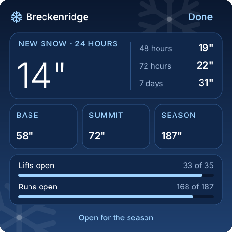

A winter-themed ski report for a mountain house. A snowflake chip in the
status bar shows the last 24 hours of new snow; tap it for the sheet: new
snow (24 hours, 48 hours, 72 hours, 7 days), base and summit depth, season
total, lifts and runs open, and opening day (or "Open for the season").

```yaml
- path: features/snow_report.yaml
  vars:
    title: "Breckenridge"
    chip_slot: 5                       # status-chip order (1 = rightmost)
    chip_show: "nonzero"               # or "always"
    new_24h_entity: sensor.resort_new_snow_24h
    new_48h_entity: sensor.resort_new_snow_48h
    new_72h_entity: sensor.resort_new_snow_72h
    new_7d_entity: sensor.resort_new_snow_7d
    base_entity: sensor.resort_base_depth
    summit_entity: sensor.resort_summit_depth
    season_entity: sensor.resort_season_snowfall
    lifts_entity: sensor.resort_lifts_open      # attribute `total` = all lifts
    runs_entity: sensor.resort_runs_open        # attribute `total` = all runs
    opening_entity: sensor.resort_opening_date  # YYYY-MM-DD
    powder_inches: "3"                 # optional: powder-day note ("0" = off)
```

Values are inches. Any entity you don't have can name one that doesn't exist;
it shows "-". `chip_show: "nonzero"` shows the chip only after new snow.

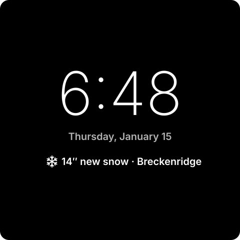

**Powder day:** after at least `powder_inches` of new snow in 24 hours, the
sleeping panel shows the clock with the total under the date
("14″ new snow · Breckenridge"), even when Sleep screen is Blank. A panel
already asleep switches over when the report updates; it goes back to your
Sleep screen setting once the 24-hour total drops below the threshold.

## Camera pop-ups

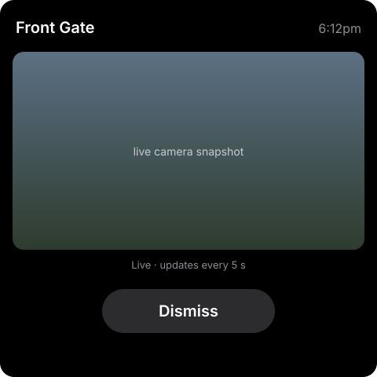

When an entity turns on — a gate opening, a doorbell press, motion — the
panel wakes and shows that camera, refreshing every few seconds. It closes on
**Dismiss**, a tap on the image, or after a minute.

```yaml
- path: features/camera_popup.yaml
  vars:
    popup_id: doorbell                      # unique per pop-up
    title: "Doorbell"
    trigger_entity: binary_sensor.front_doorbell_visitor
    camera_entity: camera.front_doorbell
```

Include it once per trigger. Snapshots come through Home Assistant's camera
proxy (so `ha_url` must be right); a camera's low-resolution "fluent" or
substream entity loads fastest. Each refresh briefly pauses touch while the
image downloads, which is why the default is every 5 seconds
(`camera_refresh_seconds`).

## Holiday themes

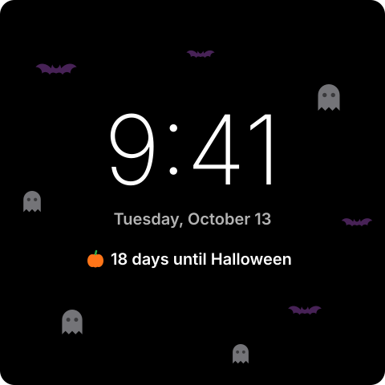

While a holiday is near, the panel takes on its colours:

- the **slider color** changes to the holiday's (your own color comes back
  afterwards);
- a small icon sits left of the status-bar clock;
- the [night clock](#screen-dimming-sleep-and-the-night-clock) shows a
  countdown under the date ("18 days until Halloween", "Halloween is
  tomorrow!", then "Happy Halloween!") and a few icons drift slowly across
  it. On a [powder day](#snow-report) the new-snow note takes the countdown's
  place.

| Holiday | When | Look |
|---|---|---|
| Halloween | Oct 1 – 31 | Orange; pumpkin; bats and ghosts float up |
| Christmas | Dec 1 – 26 | Red; pine tree; falling snow |
| Valentine's Day | Feb 7 – 14 | Pink; hearts |
| St. Patrick's Day | Mar 10 – 17 | Green; clovers in green and gold |

```yaml
- path: features/holidays.yaml
  vars: { decorations: 8 }     # optional: drifting icons (0 = none)
```

Each panel has a **Holiday Theme** switch in Home Assistant (with its other
configuration entities); themes stay off until you turn it on, so you can
choose which rooms get them. **Holiday Preview** (disabled in HA until you
enable it) shows one holiday's theme now, whatever the date, with its
greeting on the night clock; set it back to **By date** afterwards. At night, and
with the Red clock, the drifting icons turn dim red like the clock.

The icons come from the icon font, so a theme costs a few KB of flash and
very little memory. If a 480×480 panel's night clock feels slow, use
`decorations: 0`.

## Sleep screen notes

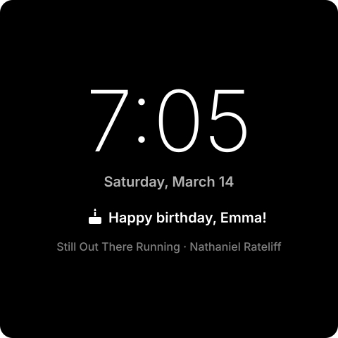

Notes from Home Assistant for the night clock, set up with ordinary helpers
(Settings → Devices & services → Helpers) — nothing reads your calendar:

- **Sleep message:** type into **Panel Sleep Message** (a text helper, up to
  60 characters) and every panel's sleep screen shows it under the date,
  e.g. "Back at 6 — Mom". Clear it to remove it. While it is set, a panel
  whose Sleep screen is Blank shows the clock instead, so it can be read.
- **Birthdays:** add a **Date** helper per person named `Birthday: Emma`
  with the birth date (any year). The week before, the clock shows "3 days
  until Emma's birthday", then "Emma's birthday is tomorrow!", and on the day
  "Happy birthday, Emma!" with a cake — on the day even on Blank sleep
  screens. Birthdays on the same day are shown together.

The order under the date is: [powder day](#snow-report), then the sleep
message, then a birthday, then a [holiday](#holiday-themes) countdown.

```yaml
- path: features/sleep_notes.yaml
```

Needs `panel_notes.yaml` in Home Assistant (see
[Home Assistant side](home-assistant.md#packages-to-install)), which also
sends **reminders** (see [Messages](#messages-from-home-assistant)).

## Voice

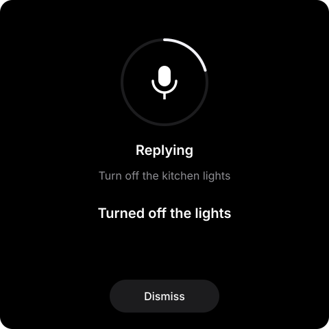

On a panel with a speaker and microphones (the Waveshare P4), say **"Okay
Nabu"** and ask Home Assistant anything Assist understands: "turn off the
kitchen lights", "what's the weather tomorrow?", "set a timer for 10
minutes". The panel wakes, shows **Listening… → Thinking… → Replying** with
what it heard and the answer, and speaks the reply. Tap anywhere (or
**Dismiss**) to cancel.

```yaml
- features/voice_assistant.yaml
```

- **Microphone icon** in the status bar: tap it to stop listening for the
  wake word (it turns into a red crossed-out mic), tap again to resume. It's
  also the *Mute Wake Word* switch in HA.
- **Settings → Voice** (on the panel): the wake word (**Okay Nabu** or **Hey
  Jarvis**), **Mute wake word**, and **Reply volume**.
- **Wake word:** "Okay Nabu" is on by default. Choose it in Settings → Voice
  or on the panel's device page in HA. The Assist pipeline (language, speech
  engines, which conversation agent) is chosen on the device page.
- **Speaker:** replies and HA announcements play on the panel's own speaker
  (the *Panel Speaker* media player in HA; its volume is the reply volume,
  also set in Settings → Voice).
- **Timers** set by voice show and ring on the [Timer tab](#timer-tab), if
  the panel has one.
- The panel can't listen and play at the same time: while the panel's own
  speaker plays music, the wake word pauses. Speakers elsewhere in the room
  (a Sonos playing on the Music tab) don't affect it.

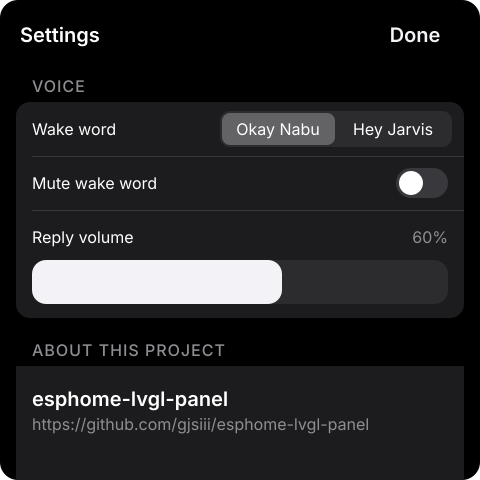

Set up Assist in Home Assistant first (Settings → Voice assistants). See
[Home Assistant side](home-assistant.md#voice) for the entities.

## Messages from Home Assistant

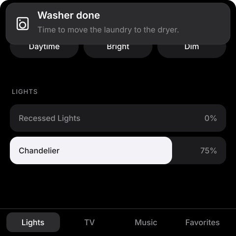

Any automation can put a banner on any panel: an icon, a title and a line or
two of text. It sits on top of everything, disappears after a set time (or
stays until tapped), and wakes a sleeping panel.

```yaml
# In an HA automation or script (needs ha/panel_messages.yaml)
action: script.panel_message
data:
  panels: [esp-living-room-panel, esp-kitchen-panel]
  title: Washer done
  message: Time to move the laundry to the dryer.
  icon: washer       # info alert bell door gate mail washer car check
  seconds: 30        # 0 = until tapped
```

**Reminders without the calendar:** with `panel_notes.yaml` installed, add a
**Schedule** helper named `Reminder: Trash night` and give it its weekly
times (say Monday 19:00–19:15). When a time block starts, the panels listed
in the package get a "Trash night" banner with a bell, which stays until
tapped. Edit the `panels:` list at the top of the package to choose which
panels get reminders.

Each panel also offers `esphome.<panel_name>_show_message` and
`esphome.<panel_name>_clear_message` directly (dashes in the name become
underscores). See [Home Assistant side](home-assistant.md#messages) for
examples.

## Settings

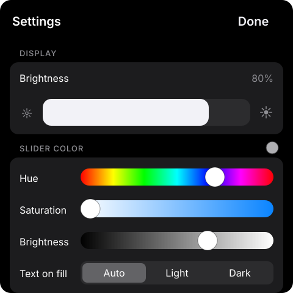

Tap the **gear**. The sheet scrolls; it closes with **Done** or when the
screen dims. Every setting is saved on the panel and also appears in Home
Assistant (device page → Configuration), so you can change panels remotely.

| Section | Setting | What it does |
|---|---|---|
| Display | **Brightness** | Backlight level when the panel is in use. |
| Slider color | **Hue / Saturation / Brightness** | Color of every slider, the progress bar and switches. Saturation 0 gives a grey; in HA this is the **Slider Color** light, with a color wheel (turn it off for the default). |
| | **Text on fill** | Color of slider names/percentages where the colored fill is under them: Auto (dark or white by contrast), Light or Dark. |
| Screen | **Dim after** | 15 s, 30 s, 1 min, 2 min or Never. |
| | **Turn off after** | 1, 5, 10, 30 min or Never. |
| | **Sleep screen** | What "off" looks like: Blank, Clock or Red clock. |
| Night | **Night mode**, **Starts**, **Ends**, **Night brightness** | See [Night mode](#night-mode). |
| Options | **24-hour clock** | 14:30 instead of 2:30pm. |
| | **Auto-open TV & Music** | Bring up the TV or Music tab when playback starts. |
| | **Messages wake at full brightness** | Off: messages wake a sleeping panel dimly. On: to your brightness. |
| | **Lock settings with PIN** | See [PIN lock](#pin-lock). |
| Voice | **Wake word**, **Mute wake word**, **Reply volume** | Panels with [voice](#voice) only. |
| About | | See [About and restart](#about-and-restart). |

## Screen dimming, sleep and the night clock

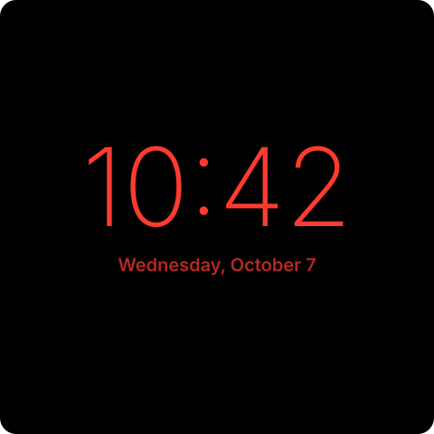

- After **Dim after**, the backlight fades to the dim level (30%, or your
  brightness if that's lower). A touch brings it back and works normally.
- After **Turn off after**, the panel sleeps:
  - **Blank** — backlight off. The first tap only wakes the panel; it never
    presses whatever is underneath.
  - **Clock / Red clock** — a large, dim clock and date that shifts a few
    pixels every minute. A tap wakes the panel.
  - On a [powder day](#snow-report) the clock is shown, with the new snow
    under the date, even when Sleep screen is Blank.
  - With a [holiday theme](#holiday-themes) on, the clock shows the countdown
    under the date and a few holiday icons drift past.
  - A [sleep message or birthday](#sleep-screen-notes) shows under the date
    (and, on the day, turns a Blank sleep screen into the clock).
  - While music plays, a dimmer line under that shows the title and artist.
- Any open sheet (Settings, Weather, Climate…) closes when the screen dims, so
  the panel always wakes to its tabs.
- **Presence wake** (optional) wakes a sleeping panel to the dim level when an
  occupancy sensor turns on:

  ```yaml
  - path: features/presence_wake.yaml
    vars: { presence_entity: binary_sensor.living_room_occupancy }
  ```

- **Anti-burn:** between 1 and 6 am the panel shows moving "snow" for a while
  each hour to exercise every pixel.

## Night mode

Settings → **Night**: turn on **Night mode** and choose when night **Starts**
(8 PM–12 AM) and **Ends** (5–9 AM), and the **Night brightness** (20 / 30 / 45%).
During those hours:

- The screen never gets brighter than the night brightness — when touched,
  when a message arrives, or when woken by presence.
- When the panel sleeps it shows the **red night clock**, whatever the Sleep
  screen setting says.
- At the start and end of the night an awake screen eases to the new
  brightness.

Typical use: bedside and kids' rooms.

## PIN lock

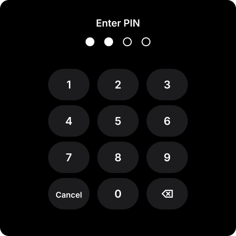

Keeps the Settings sheet behind a 4-digit PIN — useful in kids' rooms, guest
rooms and rentals.

1. Settings → Options → turn on **Lock settings with PIN**.
2. Choose a 4-digit PIN on the keypad. The switch turns on once it's set.
3. From now on the gear opens the keypad; the right PIN opens Settings. It
   relocks when the screen next dims.

**Forgot the PIN?** In Home Assistant, on the panel's device page, turn off
**Settings PIN Lock** or clear **Settings PIN**. Automations can lock and
unlock the panel the same way.

## Cleaning mode

Tap the **spray bottle** at the top of Settings (or press **Cleaning Mode** on
the panel's device page in Home Assistant). Touch is ignored for 30 seconds
while a countdown shows, then everything works again by itself.

## Updates

With `ha/panel_updates.yaml` installed in Home Assistant, Settings shows a
green **Update available** card at the top when a newer version of these
files has been released, and About shows "up to date" or the new version.
To update, change `ref:` in the display file's `packages` to the new tag and
install. Without the HA package nothing is shown. (Display files on another
sensor name can set `update_entity` in `substitutions`.)

## About and restart

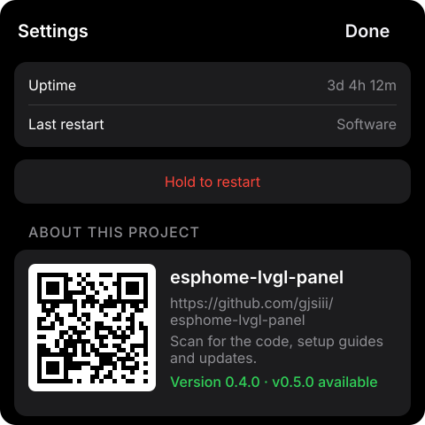

At the bottom of Settings: device name, panel version, ESPHome version, IP
address, Wi-Fi network and signal, uptime, and the reason for the **last
restart** (useful for spotting power problems — see
[Troubleshooting](troubleshooting.md)). **Hold to restart** reboots the panel
(holding prevents accidental restarts). Below it, **About this project** shows
a QR code, the link to this repository and the panel version, which turns
green with "vX.Y.Z available" when a newer release is out (see
[Updates](#updates)). IP, signal, uptime, reset reason and Restart are also in
Home Assistant.
